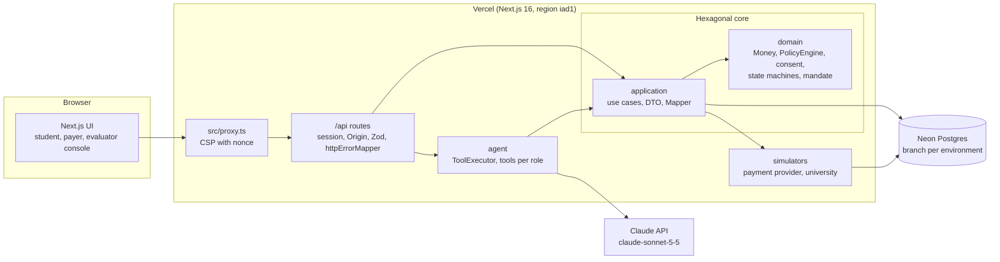

# ArrivalGuard

An AI agent that pays a student's international tuition inside the limits their family sets, follows the money until the university confirms it, and never pays twice.
It also sends arrival-expense transfers under a standing permission and files refund requests for verified overpayments.
Everything runs in a **simulated** environment: synthetic funds, a fictional university and a simulated payment provider. No real money moves.

- **Live demo:** https://arrivalguard.vercel.app
- **Evaluation code:** `<EVAL_ACCESS_CODE>` (provided in the judging packet)
- **Guide for judges:** [docs/DEMO_GUIDE.md](docs/DEMO_GUIDE.md)

FinTechathon 2026, International Track.

## Architecture



- `src/domain` is pure TypeScript (no Next.js, database or SDK imports; enforced by `tests/unit/architecture.test.ts`).
- Identity, role and workspace come only from the server session, never from the request body, a tool argument or the model.
- The model has no tools to approve, change limits, add recipients, move the clock, inject faults or mark anything credited.

Details: [docs/TECHNICAL.md](docs/TECHNICAL.md). Security: [docs/SECURITY_SELF_ASSESSMENT.md](docs/SECURITY_SELF_ASSESSMENT.md).

## Requirements

- Node.js 24 and pnpm 12 (`npm install -g pnpm@12.14.0`).
- A PostgreSQL database. The project uses [Neon](https://neon.tech) with a `dev` branch for local work and tests and a separate branch for production. You need two connection strings: a pooled one for the app and a direct one for migrations (with plain Postgres both can be the same).
- An Anthropic API key with access to `claude-sonnet-5-5` (only needed for the chat; everything else, including the test suite, works without it).
- Git. Windows, macOS and Linux are supported; all scripts are TypeScript run with `tsx` (no shell scripts).

## Install from scratch

Run these commands in order from the repository root.

```bash
pnpm install
```

Copy the example environment file and fill it in:

```bash
cp .env.example .env.local
```

On Windows, `cp` works in PowerShell and Git Bash; in `cmd.exe` use `copy .env.example .env.local`. The commands in this README are one per line, so they also work in Windows PowerShell 5.1, which has no `&&`.

Fill in `.env.local` (it is ignored by git):

| Variable | What to put |
|---|---|
| `DATABASE_URL` | Pooled connection string of your development database |
| `DATABASE_URL_UNPOOLED` | Direct connection string of the same database (used by migrations and one test) |
| `ANTHROPIC_API_KEY` | Your Anthropic key (optional for tests; required for the chat) |
| `SESSION_PEPPER` | A random secret: `node -e "console.log(require('crypto').randomBytes(32).toString('base64url'))"` |
| `EVAL_ACCESS_CODE` | Any code of 8 characters or more; it opens a demo workspace |

The other variables have working defaults in `.env.example`.

Apply the database migrations (additive only):

```bash
pnpm db:migrate
```

Run the test suite (unit, integration, API and security tests; integration tests use the database from `.env.local` and take a few minutes because each test creates its own workspace):

```bash
pnpm test
```

Start the app:

```bash
pnpm dev
```

Open http://localhost:3000, go to **For judges**, enter your `EVAL_ACCESS_CODE` and choose a scenario.

## Environment variables

The variables are listed, without secret values, in [`.env.example`](.env.example):

`DATABASE_URL`, `DATABASE_URL_UNPOOLED`, `ANTHROPIC_API_KEY`, `ANTHROPIC_MODEL`, `SESSION_PEPPER`, `EVAL_ACCESS_CODE`, `EVAL_SESSION_TTL_HOURS`, `EVAL_ACCESS_PER_IP_HOUR`, `EVAL_WORKSPACES_PER_DAY`, `AI_BUDGET_PER_WORKSPACE_USD`, `AI_BUDGET_DAILY_USD`, `AI_BUDGET_PER_ORIGIN_DAILY_USD`, `SCRIPTED_TASKS_PER_WORKSPACE_HOUR`, `SCRIPTED_TASKS_PER_ORIGIN_DAY`, `SCRIPTED_TASKS_PER_DAY`, `PRICE_INPUT_PER_MTOK_USD`, `PRICE_OUTPUT_PER_MTOK_USD`, `PRICE_CACHE_READ_PER_MTOK_USD`, `PRICE_CACHE_WRITE_PER_MTOK_USD`, `APP_BASE_URL`.

Optional tuning variables, such as `AI_TURNS_PER_MINUTE` and `AI_TURNS_PER_DAY` (chat turns per workspace), have defaults in `src/infrastructure/config/env.ts`, which validates the server environment with Zod and names a missing or invalid variable without printing any value.

Secrets live only in server environment variables. They are never printed by the scripts and `pnpm secrets-scan` fails if one appears in a tracked file.

## Deployment

- Vercel project linked to this repository; production branch `main`, region `iad1` (`vercel.json`).
- Install command: `npm install -g pnpm@12.14.0 && pnpm install --frozen-lockfile`.
- Build command: `pnpm db:migrate && pnpm build` (migrations are additive and run against the production database branch).
- Environment variables are set in Vercel: Production uses the production database branch, Preview uses `dev`.
- After each production deploy: `pnpm smoke --base-url https://arrivalguard.vercel.app --code <EVAL_ACCESS_CODE>` (or with that code in `.env.local`).

## Tests and evaluations

| Command | What it does |
|---|---|
| `pnpm verify` | Typecheck, lint, all tests, scenario check, build and secrets scan. Must be green before merging to `main`. |
| `pnpm test` / `pnpm test:unit` | All tests / unit tests only (no database). |
| `pnpm db:seed-check` | Validates the synthetic scenarios and their expected numbers. |
| `pnpm ui:check --base-url http://localhost:3000` | Playwright: tuition payment end to end with clicks, the console's Run T1 to T8, an arrival transfer, screenshots in `docs/design/screens/`, axe checks and CSP console checks. Run `pnpm exec playwright install chromium` once, and start the app first: `pnpm build`, then `pnpm start`. |
| `pnpm smoke --base-url <url> [--code <code>]` | Health, simulation banner and a tuition payment by HTTP until `CREDITED`. It needs the evaluation code of the deployment it targets: without `--code` it reads `EVAL_ACCESS_CODE` from `.env.local`; against the public demo use the code from the judging packet. |
| `pnpm smoke:chat --base-url <url>` | A tuition payment through the chat with the real model until `CREDITED`; saves the transcript in `docs/evidence/`. |
| `pnpm ai:check` | One real call to Claude with the production model configuration and a strict tool. |
| `pnpm ai:turns` | A 20-turn conversation with the real model against the development database; saves `docs/evidence/agent-turns-*.json`. |
| `pnpm eval:deterministic` | N, O and S scenarios at API level, without AI; results in `docs/results/`. |
| `pnpm eval:agent [--repeat 1\|3]` | D scenarios, natural-language versions of the tasks and the agent-level attacks with the real model, judged by server state; results in `docs/results/`. |
| `pnpm tasks:run --base-url <url> [--code <code>]` | Runs tasks T1 to T8 by HTTP against a deployment, as a judge's script would; request logs in `docs/evidence/`, summary in `docs/results/`. Without `--code` it reads `EVAL_ACCESS_CODE` from `.env.local`. |
| `pnpm results:report` | Builds `docs/results/RESULTS.md` and the result tables in `docs/EVALUATION.md` and `docs/SECURITY_SELF_ASSESSMENT.md` from real result files only. |
| `pnpm secrets-scan` | Fails if a key-like value or a real secret from the environment appears in any tracked file. |
| `pnpm run licenses` | Regenerates `THIRD_PARTY_LICENSES.md` from the installed production dependencies (`run` is needed because `pnpm licenses` alone is a built-in pnpm command). |

The evaluation results, with commit and date, are in [docs/EVALUATION.md](docs/EVALUATION.md) and `docs/results/`. How to read the evidence files: [docs/EXECUTION_EVIDENCE.md](docs/EXECUTION_EVIDENCE.md).

## Repository structure

```
src/
  domain/          Money, policy engine, consent and fingerprints, state machines, mandate, refunds, ports
  application/     use cases, DTO, Mapper, typed errors, agent ports and the chat turn
  infrastructure/  database (Drizzle), simulators, scenarios, Claude adapter, sessions, config
  interfaces/      HTTP wrapper and error mapper, agent tool catalog and executor
  app/             Next.js pages and thin /api route handlers
  ui/              brand, primitives, finance components, chat, console, layout, theme
  proxy.ts         Content Security Policy with a per-request nonce
tests/             unit, integration, api and security tests (Vitest)
scripts/           verify, migrate, smoke, ui-check, evaluations and checks (TypeScript, tsx)
drizzle/           SQL migrations
docs/              technical, security and evaluation documents, reviews, evidence and results
```

## Limits

- **Simulated, by design.** Funds, accounts, the payment provider and Arrival University are synthetic. No real money moves and no real institution is contacted.
- **What the simulation does not demonstrate:** real fees, coverage, latency, settlement times or KYC and compliance checks. Exchange rates and route prices are fixed synthetic quotes.
- **One family, one student, one obligation per workspace.** Each workspace is isolated; the evaluator can open new ones.
- **Assistant availability.** The chat depends on the Claude API and on per-workspace and daily budgets. When it is unavailable, the interface switches to structured controls and nothing is lost.
- Known risks and residual risks are listed in [docs/SECURITY_SELF_ASSESSMENT.md](docs/SECURITY_SELF_ASSESSMENT.md).

## License

MIT, see [LICENSE](LICENSE). Third-party licenses: [THIRD_PARTY_LICENSES.md](THIRD_PARTY_LICENSES.md).
