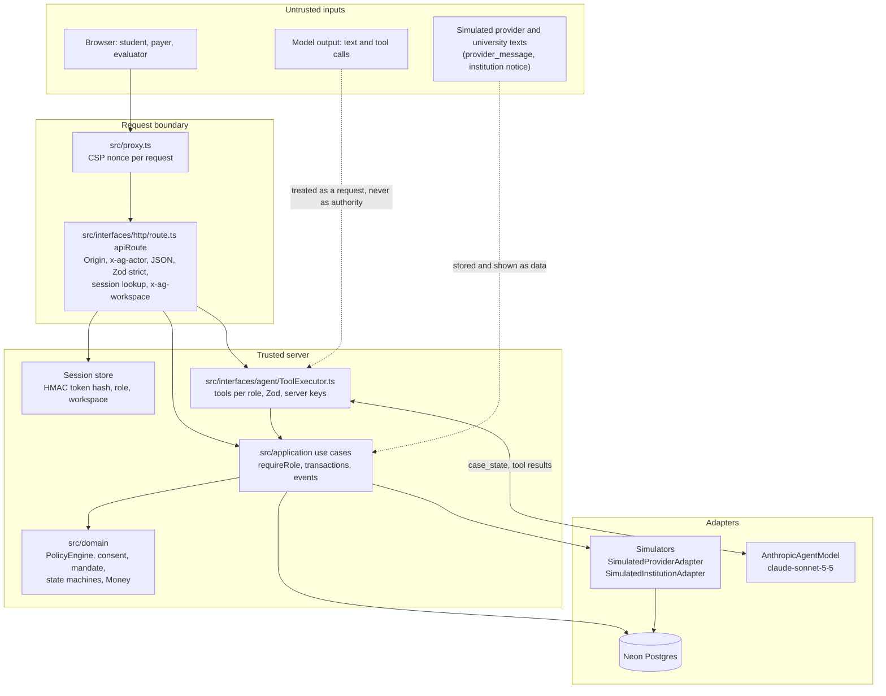

# ArrivalGuard technical design

This document describes how ArrivalGuard is built, as it is in the code. File paths are relative to the repository root. Decisions are cited by their identifier in [DECISIONS.md](DECISIONS.md) (written in Spanish). Everything runs on synthetic data: the payment provider, the university and all funds are simulated.

## 1. Architecture and trust boundaries

ArrivalGuard is a Next.js 16 application (App Router) deployed on Vercel, with PostgreSQL on Neon and Claude as the language model. The code follows a hexagonal (ports and adapters) layout with a pure domain.

Trust rules enforced by the code:

- **Identity comes only from the session.** `resolveActor` in `src/interfaces/http/session.ts` reads the role cookie selected by `x-ag-actor` and returns `{ workspaceId, actorId, role }` from the stored session. Request bodies are strict Zod schemas (`src/interfaces/http/schemas.ts`), so a `workspaceId`, `actorId` or `role` field in a body is rejected with 422.
- **The model is untrusted.** Its tool calls go through `ToolExecutor`, which only offers the tools of the session role, validates arguments with Zod, takes the actor from the session and derives idempotency keys on the server. There is no tool that approves, confirms a payer change, adds a recipient, moves the clock, injects faults or marks a payment credited (test `tests/unit/agentTools.test.ts`).
- **Simulated third-party texts are data.** The provider's `provider_message` and the university notice can carry injected instructions (faults `PROVIDER_INJECTION_TEXT` and `INSTITUTION_INJECTION_TEXT`). They are stored and displayed as data and never change a receiver, an approval or a credit (tests S11 and S12).
- **Pure domain.** `src/domain` imports nothing from Next.js, Drizzle, `pg` or the Anthropic SDK; `tests/unit/architecture.test.ts` enforces it.

Layers:

| Layer | Folder | Contents |
|---|---|---|
| Domain | `src/domain` | `Money` and `Rate`, `PolicyEngine`, `RemittancePolicy`, consent (`Approval`, `ApprovalPayload`, `canonicalJson`, `MaterialChange`, `RequoteScope`, `StandingMandate`), `PaymentPlan`, `PaymentAttempt`, `ExecutionGuard`, `RefundClaim`, `CashProjection`, `SecuritySignals`, ports |
| Application | `src/application` | One class per use case in `usecases/`, services (`TuitionPlanner`, `TuitionPaymentProcessor`, `RefundProcessor`, `PayerPolicyService`, `RemittanceContext`, `TuitionContext`), DTO, `*Mapper` classes, typed `ApplicationError` |
| Infrastructure | `src/infrastructure` | Drizzle schema, repositories and unit of work, simulators, scenarios, Claude adapter and system prompt, session store, redaction, environment config |
| Interfaces | `src/interfaces` | `apiRoute` wrapper, `httpErrorMapper` (the only error to HTTP mapping), presenters, agent tool catalog and `ToolExecutor`, money formatting |
| App | `src/app` | Pages and thin `/api` route handlers |

## 2. Data model

PostgreSQL schema in `src/infrastructure/db/schema.ts`, with SQL migrations in `drizzle/` (applied by `pnpm db:migrate`, additive only). Every business table carries `workspace_id` and every query filters by it. Money is `bigint` minor units plus a currency column; virtual times are separate columns.

There are 29 tables:

| Group | Tables |
|---|---|
| Workspace and identity (3) | `workspaces` (scenario, virtual clock, active faults, event sequence, expiry), `actors` (one per role), `sessions` (token hash, role, expiry, revocation) |
| Money and limits (5) | `accounts` (balance in minor units, masked number), `earmarks` (arrival reserve), `holds` (one per attempt), `payer_policies` (maximum tuition debit and reserve, versioned), `standing_mandates` (purpose, recipient, period maximum, period days, expiry, status) |
| Obligations and payees (2) | `obligations` (tuition invoice, net due, reference, due date), `recipients` (masked account, verified flag, account status) |
| Planning and consent (3) | `payment_plans` (one row per plan version, selected route and engine evaluation), `approvals` (subject, version, fingerprint, canonical payload, status), `pending_changes` (payer changes prepared by chat and confirmed on a fixed screen, with fingerprint) |
| Execution (3) | `payment_attempts` (idempotency key, status, submit lease), `remittances` (arrival transfers), `refund_claims` |
| Cash projection (2) | `conditional_incomes` (scholarship, never counted until received), `expected_expenses` |
| Evidence (2) | `domain_events` (append-only, sequenced per workspace), `processed_provider_events` (deduplication of provider events) |
| Agent (4) | `conversations`, `conversation_turns`, `ai_usage` (reserved and settled cost per model call), `rate_limits` |
| Simulators (5) | `sim_provider_quotes`, `sim_provider_transfers`, `sim_provider_events`, `sim_institution_ledger`, `sim_institution_refunds` |

Integrity constraints that carry business rules:

- `payment_attempts_workspace_key_uq`: one attempt per idempotency key per workspace.
- `payment_attempts_one_active_per_subject_uq`: a partial unique index; at most one attempt in `SUBMITTING`, `UNKNOWN`, `PROVIDER_ACCEPTED` or `PENDING_UNIVERSITY` per plan or remittance.
- `payment_attempts_one_credited_per_obligation_uq`: at most one `CREDITED` attempt per obligation.
- `holds_attempt_uq`: one hold per attempt.
- `sim_provider_transfers_key_uq` and `sim_institution_ledger_transfer_uq`: the simulated provider accepts a key once and the university credits a transfer once.
- `conversations_one_active_uq`: one active conversation per role and workspace.
- A unique violation is translated to `DuplicateRecordError` even when Drizzle wraps the driver error (test VC4-3 in `tests/integration/vc4Review.test.ts`).

## 3. Core algorithms

### 3.1 Money

`src/domain/money/Money.ts`: `Money = { currency: "USD" | "CNY"; minor: bigint }`. Arithmetic is on `bigint`; there is no floating point anywhere in money code. Adding different currencies throws. A conversion requires an explicit `Rate` from a quote. DTOs carry `{ currency, minor: string }` (`MoneyMapper`). Formatting such as `USD 2,860.00` happens only at the edge (`src/interfaces/format/money.ts`).

### 3.2 Policy engine and route selection

`src/domain/policy/PolicyEngine.ts` is pure and deterministic.

1. `tuitionPlanBlockers` checks the obligation before any route: `OBLIGATION_NOT_PENDING` if it is no longer pending and `TARGET_LATER_THAN_DUE_DATE` if the requested arrival target is later than the due date. The student can only make the target stricter.
2. `evaluateTuitionQuote` checks each quote and returns every reason that applies:
   - `DEADLINE_MISSED` (now plus the route's arrival time is after the target),
   - `NET_INSUFFICIENT` (net amount lower than the net due, or another currency),
   - `RECEIVER_NOT_ALLOWED` (not the account registered by the university),
   - `CHANNEL_NOT_ALLOWED`,
   - `QUOTE_EXPIRED`,
   - and the debit checks from `tuitionDebitReasons` in `src/domain/cash/CashInvariants.ts`: `EXCEEDS_PAYER_MAX` (cumulative per obligation, including debits already committed), `BREAKS_RESERVE` and `INSUFFICIENT_FUNDS` (DEC-012).
3. `evaluateTuitionRoutes` keeps the viable routes and orders them with `compareForSelection` (`src/domain/policy/RouteQuote.ts`): **lowest debit first, then fastest arrival, then route id**. The first one is selected; every discarded route keeps its reasons so the interface and the model can explain them.

With the `base` scenario (configuration in `src/infrastructure/scenarios/definitions.ts`, checked by `pnpm db:seed-check`), a 48 hour target selects route B at USD 2,860.00 and a 6 hour target selects route D at USD 2,880.00; a 1 hour target has no viable route.

Arrival transfers use `src/domain/policy/RemittancePolicy.ts`: `remittanceBlockers` returns `RECIPIENT_ACCOUNT_NOT_OPEN` or `RECIPIENT_NOT_VERIFIED` before quoting, and `evaluateRemittanceRoutes` applies the same selection order.

### 3.3 Consent with a fingerprint

A payer approval binds an exact set of terms:

- `buildTuitionApprovalPayload` (`src/domain/consent/ApprovalPayload.ts`) builds the payload with these fields: `workspaceId`, `obligationId`, `obligationVersion`, `planId`, `planVersion`, `routeId`, `channel`, `receiverId`, `reference`, `sourceAccountId`, `proposedDebit`, `netAmount`, `maxDebit`, `reserve`, `quoteId` and `approvalExpiresAt`.
- `canonicalJson` (`src/domain/consent/canonicalJson.ts`) serializes it with sorted keys and no whitespace. `fingerprintOf` is the SHA-256 of that canonical JSON, in hex.
- `approvalExpiresAt` is fixed when the approval is requested: the earlier of request time plus 24 virtual hours and the obligation due date (`approvalExpiry` in `src/domain/consent/Approval.ts`, DEC-012), so the fingerprint the payer sees is the one the server verifies.
- `GrantApprovalUseCase` accepts only a payer session, recomputes the fingerprint of the current plan version and stores the approval only if the version and the fingerprint presented by the payer screen match it. A different version or fingerprint is a 409 (`VERSION_CONFLICT`), with no approval stored (test S16).
- Payer limit and mandate changes prepared by chat follow the same idea: `ConfirmPayerChangeUseCase` accepts only the payer and only the fingerprint of the change that was shown.
- At execution, `Approval.signedTuitionPayload` re-verifies the stored payload against its fingerprint before any field is trusted.
- `MATERIAL_FIELDS` (`src/domain/consent/MaterialChange.ts`) are `obligationId`, `obligationVersion`, `routeId`, `channel`, `receiverId`, `sourceAccountId`, `netAmount` and `reference`. A replan that changes any of them creates a new plan version and invalidates the previous approval, recording which fields changed. A payer limit change that the approved plan no longer fits also invalidates it (`policyChangeReasons`).

Remittance approvals (needed when a transfer exceeds the standing permission) use `buildRemittanceApprovalPayload` with the same canonical JSON and fingerprint, valid for 24 virtual hours.

**The seal is a visual representation of the fingerprint; security comes from server verification.** The round seal drawn on the approval document (`src/ui/brand/ConsentSeal.tsx`) is derived from the fingerprint so a person can see that two approvals differ. It has no cryptographic role.

### 3.4 Requote scope (amendment A3)

Quotes are valid for 15 virtual minutes. If the approved quote has expired at execution, `ExecuteTuitionPaymentUseCase` asks the provider to requote **the same route**, and `checkRequoteWithinApproval` (`src/domain/consent/RequoteScope.ts`) allows the new quote only if:

- the approval is still usable (active, same plan id, version and fingerprint, not expired),
- route, channel, receiver and net amount equal the signed payload,
- the new debit stays within the effective maximum, the lower of the approved maximum and the payer's current maximum, and keeps the effective reserve, the higher of the two (DEC-012),
- the new quote is valid and still meets the arrival target.

When allowed, the event `AUTO_REQUOTE_WITHIN_APPROVAL` records both debits. When not, the payment is blocked (`EXECUTION_BLOCKED` with stage `REQUOTE`), the approval becomes `INVALIDATED` and the plan returns to `READY_FOR_APPROVAL`.

### 3.5 Idempotent transactional executor

`ExecuteTuitionPaymentUseCase` (`src/application/usecases/ExecuteTuitionPaymentUseCase.ts`) with `TuitionPaymentProcessor` (`src/application/services/TuitionPaymentProcessor.ts`):

1. **Key.** The idempotency key is the client's key, or, for the agent, one derived by the server: `tuition:{planId}:v{version}:{approvalId}`. The request content hash is stored with the attempt. The same key with the same content returns the existing attempt (`replayed: true`); the same key with different content is a 409 `IDEMPOTENCY_CONFLICT`.
2. **One transaction, under row locks** in a fixed order (payer account, then obligation, then plan or remittance, then attempt; `lockChain`). Inside it:
   - re-checks that no other attempt is active (otherwise 409 `ACTIVE_ATTEMPT_EXISTS`),
   - runs `checkTuitionExecution` (`src/domain/payment/ExecutionGuard.ts`), which requires an approval whose signed payload matches this workspace, plan id and version, obligation and version, source account and reference, and a quote in scope, plus the receiver, channel, net, cumulative maximum and reserve checks,
   - **persists the attempt as `SUBMITTING`, places the hold and consumes the approval before anything is sent** (test `tests/integration/persistBeforeSend.test.ts`).
3. **Send outside the transaction** with the same idempotency key. A 30 second submit lease (`submit_lease_until`) marks that a send is in flight, so a reconciliation that arrives meanwhile does not resend (VC4-2).
4. **Apply the result** in a new locked transaction: `PROVIDER_ACCEPTED` captures the hold and debits once; `FAILED_CONFIRMED` releases the hold once and requires a new approval for any new attempt.

The simulated provider (`src/infrastructure/simulators/provider/SimulatedProviderAdapter.ts`) writes a `PROCESSING` transfer row with `onConflictDoNothing` on the key, so concurrent submissions with one key produce one transfer. With the fault `LOSE_NEXT_PROVIDER_RESPONSE` it persists the acceptance and then the adapter throws a timeout, which gives reconciliation a real fact to recover.

### 3.6 UNKNOWN and reconciliation of the same attempt

Only a provider timeout moves an attempt to `UNKNOWN` (`markUnknown`, event `ATTEMPT_UNKNOWN` with `nextStep: RECONCILE_SAME_ATTEMPT`). Any other error is either a confirmed failure or a send that never reached the provider (in which case the attempt stays `SUBMITTING` and reconciliation resends with the same key, VC4-7).

`ReconcilePaymentUseCase` and `TuitionPaymentProcessor.reconcile` look the transfer up by the **same idempotency key**:

- the provider has it accepted: the attempt moves to `PROVIDER_ACCEPTED` via `RECONCILIATION` and the debit happens once;
- the provider reports it failed: the attempt becomes `FAILED_CONFIRMED` and the hold is released once;
- the provider has no record: the same attempt is sent again with the same key (idempotent at the provider), unless a send is still in flight under the lease. A send that could still be in flight is never declared failed.

A new payment is never created while an attempt is `UNKNOWN`: a second execute request gets 409 `ACTIVE_ATTEMPT_EXISTS`, and the agent's "pay again" becomes a reconciliation.

Duplicate provider events are recorded in `processed_provider_events` and ignored (`DUPLICATE_EVENT_IGNORED`).

### 3.7 State machines

Every transition outside these tables throws `InvalidTransitionError` (`src/domain/shared/StateMachine.ts`).

| Entity | Transitions (file) |
|---|---|
| Payment plan (`src/domain/payment/PaymentPlan.ts`) | `DRAFT` to `NOT_VIABLE` or `READY_FOR_APPROVAL`; `READY_FOR_APPROVAL` to `APPROVAL_REQUESTED`; `APPROVAL_REQUESTED` to `APPROVED`; `APPROVED` to `EXECUTING` (or back to `READY_FOR_APPROVAL`); `EXECUTING` to `COMPLETED`, `INCIDENT_OPEN` or `READY_FOR_APPROVAL`. Non-final states can become `INVALIDATED` or `SUPERSEDED`. |
| Tuition attempt (`src/domain/payment/PaymentAttempt.ts`) | `SUBMITTING` to `PROVIDER_ACCEPTED`, `UNKNOWN` or `FAILED_CONFIRMED`; `UNKNOWN` to `PROVIDER_ACCEPTED` or `FAILED_CONFIRMED`; `PROVIDER_ACCEPTED` to `PENDING_UNIVERSITY`; `PENDING_UNIVERSITY` to `CREDITED`. |
| Remittance attempt (same file) | Same first two rows; `PROVIDER_ACCEPTED` to `DELIVERED`. |
| Approval (`src/domain/consent/Approval.ts`) | `ACTIVE` to `CONSUMED`, `REVOKED`, `INVALIDATED` or `EXPIRED`. |
| Refund claim (`src/domain/refund/RefundClaim.ts`) | `DRAFT` to `SUBMITTED`; `SUBMITTED` to `UNDER_REVIEW` or `REJECTED`; `UNDER_REVIEW` to `APPROVED` or `REJECTED`; `APPROVED` to `REFUNDED`. |
| Remittance record | `READY`, `APPROVAL_REQUESTED`, `APPROVED`, `BLOCKED`, `EXECUTING`, `DELIVERED`, `FAILED` (type in `src/domain/ports/Repositories.ts`). |

`CREDITED` is reached only when the simulated university credits the transfer on its own ledger at the virtual arrival time (or 36 virtual hours later with `DELAY_INSTITUTION_CREDIT`). No route accepts "credited" or "approved" from the browser or the model (test in `tests/security/apiSecurity.test.ts`). A credited obligation is not planned again (DEC-015, DEC-016).

### 3.8 Standing mandate with a rolling period (amendment A1)

`StandingMandate` (`src/domain/consent/StandingMandate.ts`) holds purpose `ARRIVAL_EXPENSES`, one verified recipient, a period maximum, the period length in virtual days, an expiry and a status.

- `usedInPeriod` sums the debits in the rolling window (now minus N days, now].
- `authorize` returns `WITHIN_MANDATE` only if the mandate is active and not expired, the purpose and recipient match, and used plus the new debit stays within the maximum. Otherwise it returns `NEEDS_PAYER_APPROVAL` with `MANDATE_REVOKED`, `MANDATE_EXPIRED`, `MANDATE_MISSING` or `EXCEEDS_MANDATE_PERIOD_LIMIT`.
- **Re-authorization under lock.** `ExecuteRemittanceUseCase` authorizes again at execution time, inside the locked transaction, with the period usage read under the same lock. Preparing several transfers that each fit and then sending them in a row cannot exceed the maximum: the one that no longer fits escalates (test "encadenar remesas listas no supera el tope" in `tests/integration/remittanceRefund.test.ts`).
- Escalation creates a one-time remittance approval for the payer, with its own fingerprint. The server key is `remittance:{id}:v{version}:{approvalId|mandate}`.

In the `arrival_remittance` scenario the maximum is USD 600.00 per 30 virtual days; a CNY 2,000.00 transfer by route R1 debits USD 288.00 within it, and a second CNY 3,000.00 transfer (USD 432.00) escalates (values from the scenario configuration and `tests/integration/remittanceRefund.test.ts`).

### 3.9 Refunds with a fixed destination (amendment A2)

`RefundClaim.prepare` (`src/domain/refund/RefundClaim.ts`) takes the verified excess from the simulated university ledger. A requested destination other than the source account throws `REFUND_DESTINATION_FIXED`; an amount above the verified excess, or no excess at all, throws `REFUND_EXCEEDS_VERIFIED_EXCESS`. The destination is always the source account. Submission uses the key `refund:{claimId}`. The USD settlement is reported by the simulated university from scenario configuration and is not a currency conversion (DEC-013).

Concurrency (VC9-1): `PrepareRefundClaimUseCase` looks for an open claim and inserts the new one inside one transaction with the obligation row locked, so parallel requests return the same claim. `SimulatedInstitutionAdapter.submitRefundClaim` checks the verified excess and inserts in one transaction under `pg_advisory_xact_lock` per workspace and reference, so claims accepted in parallel never add up to more than the excess. Submitting the same claim again with another key answers 409 (test file `tests/security/vc9Regressions.test.ts`).

### 3.10 Cash projection

`projectCash` (`src/domain/cash/CashProjection.ts`) projects per currency: confirmed balance, reserves, holds, obligations and expected expenses, with conditional income (the scholarship) listed separately and never counted. The verdict is `COVERED` or `DEFICIT` with the margin.

## 4. Agent design

### 4.1 Model configuration

`src/infrastructure/ai/AnthropicAgentModel.ts`, verified with a real call in Phase 0 (DEC-005, DEC-011): model from `ANTHROPIC_MODEL` (`claude-sonnet-5-5`), `max_tokens` 2048, `thinking: { type: "between_tools" }`, `output_config: { effort: "low" }`, the static system prompt with `cache_control`, strict tools, `tool_choice: auto`, a 25 second timeout per call and no SDK retries. The system prompt (`src/infrastructure/ai/systemPrompt.ts`) contains no secrets or configuration.

### 4.2 Tools per role

Defined in `src/interfaces/agent/toolCatalog.ts`. Schemas are flat objects with `additionalProperties: false`; amounts are decimal strings and every argument is validated again with Zod on the server.

| Role | Tools |
|---|---|
| Student | `get_case_overview`, `plan_tuition_payment`, `compare_routes`, `request_payer_approval`, `execute_approved_payment`, `get_payment_status`, `reconcile_payment`, `project_cash`, `prepare_remittance`, `execute_remittance`, `prepare_refund_claim`, `submit_refund_claim` |
| Payer | `get_case_overview`, `get_payment_status`, `reconcile_payment`, `project_cash`, `compare_routes`, `prepare_policy_change`, `prepare_mandate_change` |

The payer tools only **prepare** a change; Carlos confirms it on a fixed screen (`/w/[id]/payer/changes/[changeId]`) through `ConfirmPayerChangeUseCase`, which checks the change's fingerprint. A tool name outside the session role (or invented) is rejected with `ROLE_NOT_ALLOWED` and recorded as `SECURITY_BLOCK` with category `PRIVILEGE_ESCALATION` (`ToolExecutor`). IDs from another workspace in tool arguments resolve to `NOT_FOUND`.

### 4.3 Turn loop

`ChatTurnUseCase.execute` (`src/application/usecases/ChatTurnUseCase.ts`), configured in `src/infrastructure/container.ts`:

1. Rate limits first: 10 turns per minute and 60 per day per workspace (`AI_TURNS_PER_MINUTE`, `AI_TURNS_PER_DAY`), 429 otherwise.
2. Message length 1 to 2,000 characters.
3. `detectSecuritySignals` on the user message; matches are recorded as `SECURITY_BLOCK` events and shown as cards (section 4.6).
4. If the assistant is unavailable (fault `AI_UNAVAILABLE` or a budget already spent), the safe exit runs without calling the model.
5. Loop: at most **4 model calls** and **6 tool calls** per turn; no new model call starts after 25 seconds, so a final 25 second call plus saving fits in the route's `maxDuration` of 60 seconds (`src/app/api/chat/route.ts`). If the caps are reached, the turn ends with a fixed message and the panels show the server state.
6. The components shown in the chat (routes, cash, approval, payment, security blocks) are built from tool results and server state, not from the model's text.

### 4.4 History (amendment A5) and case state

- The last 8 turns are sent as plain text (user text and assistant text only, no tool payloads).
- Past and current user text is escaped so it cannot close `<user_message>` or open a fake `<case_state>` (VC8-2, test in `tests/integration/chatTurn.test.ts`).
- The current turn carries `<case_state>` with the real state from the server, built by `CaseStateMapper` from the role's case view: accounts masked to the last 4 digits and payer-only data filtered for the student.

### 4.5 Budget and safe exit

- Cost is estimated before each model call (system and tools estimate plus input plus the maximum output, at the prices of DEC-008) and **reserved atomically** against both caps, per workspace and per UTC day, under `pg_advisory_xact_lock` (`DrizzleAiUsageStore.reserve` in `src/infrastructure/db/repositories/aiRepositories.ts`). Concurrent turns cannot exceed a cap (VC8-1).
- After the call the reservation is settled with the real usage. A timeout keeps the estimate (it may have been billed); any other error releases it.
- Caps come from `AI_BUDGET_PER_WORKSPACE_USD`, `AI_BUDGET_DAILY_USD` and `AI_BUDGET_PER_ORIGIN_DAILY_USD` (defaults USD 3.00, USD 15.00 and USD 7.50 in `.env.example`). The per-origin cap counts the spend of every workspace opened from the same hashed IP that day, so one origin cannot use up the daily budget for everyone (VC9-7, DEC-019).
- Safe exit: on budget exhaustion, API error, timeout or refusal, the turn records `AI_FALLBACK_ACTIVATED`, returns a fixed message and the interface switches to structured controls (the same use cases without the model). Nothing is lost.

### 4.6 Security signals

`detectSecuritySignals` (`src/domain/security/SecuritySignals.ts`) labels a message with an official category: a payment to a new destination or a long account number (`INDUCED_TRANSFER`, `NEW_DESTINATION`), a claimed approval that is not a question and has no real approval behind it (`INDUCED_TRANSFER`, `CLAIMED_APPROVAL`), instruction override (`PROMPT_INJECTION`), requests for secrets (`DATA_EXTRACTION`, `SECRET_REQUEST`) and requests for full account numbers (`DATA_EXTRACTION`, `FULL_ACCOUNT_NUMBER`). **The signals are not the control.** They make attacks visible in the log and on screen; the effects are already impossible because of the server rules above. The patterns avoid labelling normal flow questions (test "no rotula pedidos normales" in `tests/unit/domain/securitySignals.test.ts`).

## 5. Security design

| Control | Where |
|---|---|
| Session token: 256 random bits; only `HMAC-SHA256(pepper, "session:" + token)` is stored | `src/infrastructure/auth/secrets.ts` (`newSessionToken`, `pepperedHash`), `DrizzleSessionStore` |
| Cookies `ag_student`, `ag_payer`, `ag_evaluator`: `HttpOnly; Secure; SameSite=Strict; Path=/`, 14 days, revocable | `src/interfaces/http/session.ts`, `/api/evaluation/workspaces`, `/api/session/logout` |
| Opening a workspace or resetting revokes the sessions the request carried | `OpenEvaluationAccessUseCase`, `/api/evaluation/reset` |
| Evaluation access: code compared in constant time; 20 attempts per hour per hashed IP and 200 workspaces per day, also on reset | `EnvAccessCode`, `DbRateLimiter` in `src/infrastructure/auth/DrizzleSessionStore.ts` |
| `x-ag-actor` only selects which browser session to use; the server checks it exists, is valid and has an allowed role | `resolveActor` in `src/interfaces/http/session.ts` |
| `x-ag-workspace`: a tab from another workspace gets 409 `WORKSPACE_MISMATCH` instead of acting on the session's workspace | `apiRoute` in `src/interfaces/http/route.ts` |
| CSRF: SameSite=Strict, Origin checked against server-defined hosts only (never `X-Forwarded-Host`), `x-ag-actor` required and `Content-Type: application/json` on every mutating route | `assertSameOrigin` and `apiRoute` in `src/interfaces/http/route.ts` |
| Role checks in every use case | `requireRole` in `src/application/ActorContext.ts` |
| Zod strict bodies and queries, body size limit, UUID path ids (bad id is 404) | `src/interfaces/http/schemas.ts`, `route.ts` |
| CSP with a per-request nonce: `script-src 'self' 'nonce-…' 'strict-dynamic'`, `frame-ancestors 'none'`, `object-src 'none'`, `base-uri 'self'`, `form-action 'self'`, `connect-src 'self'` | `src/proxy.ts` (DEC-017) |
| `X-Content-Type-Options: nosniff`, `Referrer-Policy: strict-origin-when-cross-origin`, `X-Frame-Options: DENY`, `Permissions-Policy` | `next.config.ts` |
| Model text rendered as plain text or limited markdown, never raw HTML | `src/ui/chat/assistantMarkdown.ts`, `AssistantText.tsx` |
| Redaction of event payloads and logs; masking of account numbers to the last 4 digits | `src/infrastructure/security/redact.ts` (`redact`, `maskDigits`), mappers |
| Evidence export with idempotency keys cut to 12 characters plus an ellipsis | `EvidenceMapper` |
| Secrets only in server environment variables; `pnpm secrets-scan` in `pnpm verify` | `scripts/secrets-scan.ts` |

All SQL goes through Drizzle with parameters.

## 6. Declared limits

- The payment provider, the university, accounts and funds are simulated. The system does not demonstrate real fees, coverage, latency, settlement times or KYC and compliance checks.
- Quotes, rates and refund settlements are fixed synthetic values in `src/infrastructure/scenarios/`.
- The virtual clock controls due dates, quote validity, arrivals, credits and mandate periods; only the evaluator moves it. Sessions, rate limits and budgets use real time.
- One family per workspace: one student, one payer, one tuition obligation.
- `style-src` allows `'unsafe-inline'` because components use computed `style` attributes and the toast library inserts styles (DEC-017).
- The IP used for rate limits is the platform IP on Vercel (`ipAddress()` from `@vercel/functions`); off Vercel it falls back to the first `X-Forwarded-For` value.
- Known and residual risks: [SECURITY_SELF_ASSESSMENT.md](SECURITY_SELF_ASSESSMENT.md).

**The seal is a visual representation of the fingerprint; security comes from server verification.**

## 7. Decisions cited

| ID | Topic |
|---|---|
| DEC-001 | The Neon production branch is named `production` (the documents say `main`) |
| DEC-002 | `APP_BASE_URL` per environment |
| DEC-005, DEC-011 | Model configuration validated with a real Claude call |
| DEC-007 | Library versions |
| DEC-008 | Claude Sonnet 5.5 prices used for budgets |
| DEC-009 | `sslmode=verify-full` |
| DEC-012 | Domain decisions: accepted channels, reserve and funds, effective maximum, plan versions, expiry in the fingerprint, mandate window, remittance recipient rules, virtual start time |
| DEC-013 | The USD refund is a settlement reported by the institution, not a conversion |
| DEC-014 | Network latency and the `iad1` region |
| DEC-015 | A credited attempt does not block by itself; the obligation status decides |
| DEC-016 | A credited tuition is not planned again |
| DEC-017 | CSP with nonce and the `style-src 'unsafe-inline'` exception |
| DEC-018 | A transfer approved one-off by the payer does not use up the standing permission's period maximum |
| DEC-019 | Daily AI cap per origin (hashed IP) on top of the per-workspace and daily caps |
| DEC-020 | The console's Run T1 to T8 runs on the server in new synthetic workspaces |
